# Spotify Dash

Explore your entire Spotify Extended Streaming History in a web browser or the native Android app. Import your JSON files to explore listening trends, favorites, discovery, musical mood and energy, daily rhythms, and individual playback records. No Spotify API key or login is needed.

**Your imported history stays on your device.** The web app processes data in a browser worker and remembers sanitized records in IndexedDB. Android processes and stores records locally in the app's private storage. Both discard IP addresses, usernames, and user-agent strings. Optional catalog fetching sends distinct Spotify track IDs to ReccoBeats; it does not send listening timestamps, counts, or history files. No local audio files are read, uploaded, or analyzed. Raw exports and imported datasets are excluded from the repository and production builds. The optional demo is fictional. The original web screenshots show the project owner's listening history, shared as examples; Mood & energy and Android screenshots use fictional demo data.

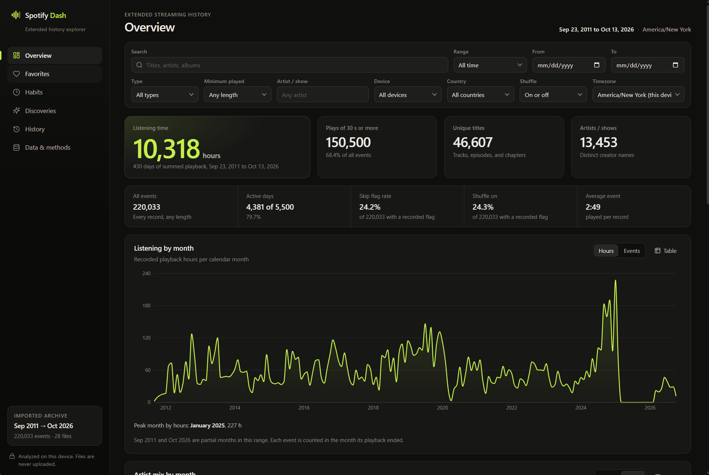

## Get your extended streaming history

Request **Extended streaming history** to explore the lifetime of your account. The separate **Account data** package includes only the past year's basic streaming history. Spotify explains the difference in [Understanding your data](https://support.spotify.com/us/article/understanding-your-data/).

1. Sign in to your [Spotify Account Privacy page](https://www.spotify.com/account/privacy/) in a browser and find **Download your data**.
2. Select **Extended streaming history** and submit the request. The other packages, **Account data** and **Technical log information**, are not needed for this dashboard.
3. Follow any confirmation prompts and check your account email for a request-confirmation message. Confirm the request if Spotify asks you to, and check spam or junk if the email is missing.
4. Wait for Spotify's email saying the download is ready. Allow around **30 days** for preparation, as described in [Spotify's guidance](https://community.spotify.com/forum/en/discussion/7376480/song-historic-by-date-and-time).
5. Download the ZIP and extract it. On Windows, right-click the ZIP and choose **Extract All**. Open the extracted **Spotify Extended Streaming History** folder.
6. Open the [Android app](#android) or [run the web dashboard](#run-locally), then select all `Streaming_History_*.json` files or choose the extracted folder. The web app also accepts drag and drop. You can import from **Data & methods** after opening either app.

Include every numbered/yearly part to cover the full export; audio and video files can be selected together. Import the extracted JSON files, not the ZIP or the included PDF. Keep the originals for your own backup. While waiting for the export, you can explore the app using its fictional demo.

If the download option is missing or the request does not arrive, see Spotify's [data download help](https://support.spotify.com/us/article/data-rights-and-privacy-settings/) for support and contact options.

## Android

Install **Spotify Dash** through **Klobstore 0.1.5 or newer**, or download the signed APK from [GitHub Releases](https://github.com/xklob/spotify-dash/releases/latest). Requires Android 9 or newer.

The native app includes all seven sections, global filters, interactive charts, searchable rankings, playback details, and full filtered CSV export. Import JSON files or an extracted export folder through Android's file picker. It works offline and requests no network or broad storage permission. Import the portable catalog metadata file to unlock Mood & energy. Each device keeps its own history; there is no account sync. On phones, Habits, Discoveries, and Data & methods are under **More**.

See the [Android guide](android/README.md) for installation, features, build instructions and release signing.

<p>
  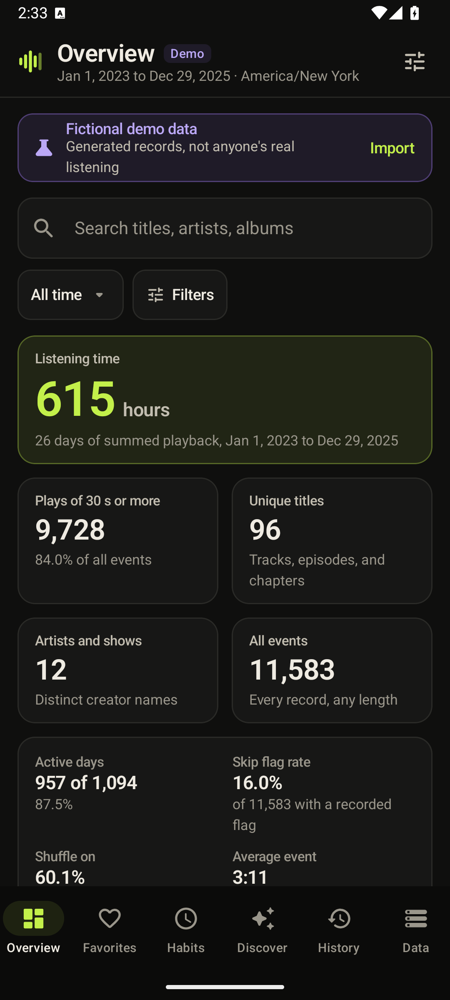
  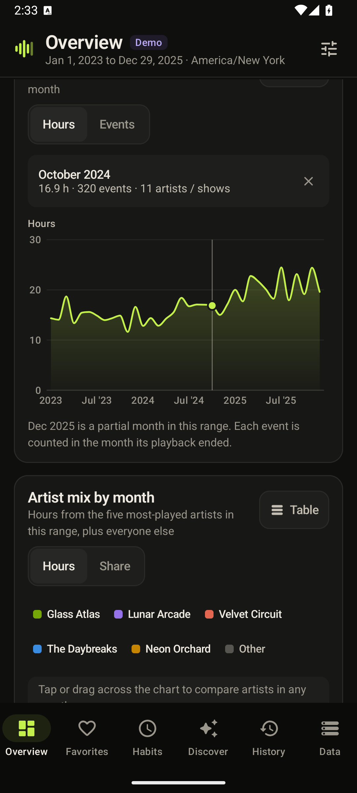
  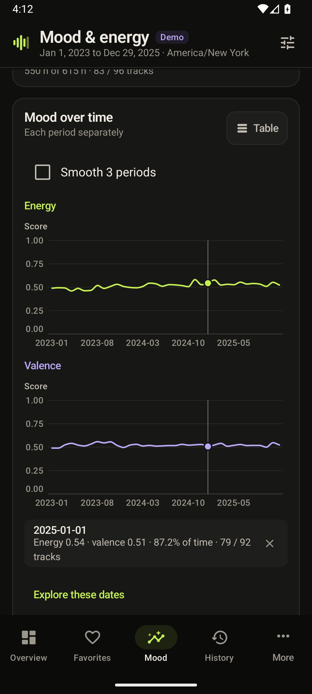
</p>

The app uses native Kotlin and Jetpack Compose. [Validation results](android/VALIDATION.md) cover parity with the web calculations, a full archive import, Android file selection and CSV export, and emulator UI checks.

## Run locally

Requires Node.js 22.12 or newer.

```sh
npm ci
npm run build
npm start
```

Open **http://localhost:4187** and choose your `Streaming_History_*.json` files. You can select all audio and video files together, or use the folder picker. Reimporting files merges the history and removes duplicate source records. Importing real history replaces the fictional demo.

For development, use `npm run dev` at the same address.

To prepare a local dataset directly from an export folder:

```sh
npm run import -- "/path/to/Spotify Extended Streaming History"
npm run build
npm start
```

On Windows with this project in WSL, a Windows folder is accessible under `/mnt/c`, for example `/mnt/c/Users/YourName/Desktop/my_spotify_data/Spotify Extended Streaming History`. The import command writes only `.local-data/history.json`, which is ignored by Git. The server binds to loopback. On first use the local app loads this file automatically, then uses its browser cache. After a later command-line import, import the updated files through the app or clear this site's browser storage to replace the cache.

Clearing data in the app deletes its browser copy and disables automatic local loading. It does not delete your original Spotify export or `.local-data/history.json`. You can import files again at any time.

## Explore

- **Overview:** listening time, qualifying plays, unique titles and creators, monthly trends, artist composition, and top favorites.
- **Favorites:** artists/shows, titles, and albums; sort by listening time or event count, search the full rankings, and drill into an artist.
- **Habits:** weekday and hourly patterns, activity calendar, devices, countries, playback endings, and skip rates with shuffle on/off.
- **Discoveries:** first-seen artists, familiar listening share, yearly comparisons, repeat obsessions, rediscoveries, and a daily listening correlation.
- **Mood & energy:** weekly/monthly trends, three-period smoothing, a two-dimensional mood distribution, weekday/hour patterns, earlier/later comparisons, sound texture, skip/repeat associations, annual coverage, and track metadata.
- **History:** searchable, paginated playback records with Spotify links and CSV export of the full filtered population.
- **Data & methods:** import management, source coverage, duplicate accounting, and definitions.

Date range, content type, minimum playback duration, search, artist, device, country, shuffle, and timezone filters apply across the app. Mood analyses use music records within those filters. The default timezone is America/New_York and can be changed. No Spotify requests are made unless you explicitly open a catalog link. ReccoBeats requests happen only when you choose **Fetch next tracks** or run the enrichment command.

## Add musical mood and catalog metadata

1. Import your listening history into the web dashboard and open **Mood & energy**.
2. Choose **Fetch next … tracks** to look up up to 400 unchecked track IDs. Frequent listening is prioritized. Each completed batch is saved, and **Stop after this batch** leaves it ready to resume. A catalog failure preserves completed batches and existing history.
3. Open **Manage metadata → Export for Android** to save `spotify-dash-metadata.json`.
4. Transfer that JSON file to Android, open **Mood & energy → Import metadata**, and select it. Use **Manage** to reopen those actions after metadata is loaded. Android uses the same calculations entirely offline. Either app can import/export this portable format.

For a large archive, the desktop command can enrich every ID and resume from its cache:

```sh
npm run import -- "/path/to/Spotify Extended Streaming History"
npm run enrich
```

The default input is `.local-data/history.json`; the output is `.local-data/metadata.json`. Reload the local dashboard to load completed metadata batches. You can also import this file directly on Android. Options include `--limit 500`, `--pilot` for a sample across listening years, `--refresh-missing` to retry IDs without both mood scores, and `--input`/`--output` for other paths. `Ctrl+C` finishes the current batch before stopping. Existing successful cache entries are reused; requests are paced, and rate limits respect `Retry-After`. An unsuccessful HTTP response is never cached as a missing track.

[ReccoBeats](https://reccobeats.com/docs/documentation/introduction) supplies third-party musical estimates: energy, valence, danceability, acousticness, instrumentalness, speechiness, liveness, tempo, loudness, and musical key/mode when available. Its catalog can also add full duration, ISRC, and credited artist names. Its [terms](https://reccobeats.com/docs/documentation/terms-of-service) distinguish Spotify-derived catalog metadata from ReccoBeats' own feature estimates; these are **not Spotify Audio Features API scores**. The provider does not publish a model revision or guarantee accuracy or complete coverage.

Only exact Spotify track IDs are joined. Missing entries remain unknown. Different releases/remixes keep separate IDs even when an ISRC or title matches. Each record retains its source, retrieval date, provider ID, and available scores; original history is unchanged. Exported metadata contains a list of track IDs and catalog names, so keep it private if you do not want to share your music choices. Do not commit your personal metadata file or publish it with the app.

| Mood measurement | Definition |
| --- | --- |
| Energy / valence | Provider estimates on a 0–1 scale. Energy describes intensity; valence describes positive musical tone. These do not measure the listener's emotions or mental health. Both scores must be present for a track to enter these paired analyses. |
| Weighting | Default: actual milliseconds played. Alternatives: one vote per event, or one vote per distinct track ID within each bucket. Zero-time events contribute only to event/track weighting. |
| Coverage | Scored music milliseconds / all selected music milliseconds. Scored and total event/track counts accompany it. Each other feature shows its own time coverage. A zero denominator is unknown. |
| Smoothing | Recalculate from the current and previous two calendar buckets, including gaps. Distinct tracks are deduplicated across the whole three-bucket window. |
| Mood distribution | All paired scores grouped into 0.1-wide energy/valence bins; cell weight follows the selected weighting. It is not a sample of top tracks. |
| Earlier / later | Split the selected inclusive calendar range into two consecutive halves; an odd extra day belongs to the earlier half. Compare coverage and date bounds before interpreting differences. |
| Energy vs skips | Pearson correlation across tracks with at least five known skip flags, comparing their energy with their skip rate. |
| Energy vs repeats | Pearson correlation across scored tracks, comparing energy with `log(1 + event count)`. Repeated listening is not an independent experiment. |
| New / familiar | First recorded local calendar day for a track versus later days, using the full archive for first-seen dates. |

Correlations require at least three nonconstant points and describe associations only. Changing coverage, listening context, or track mix can change an average. Tempo estimates can be half/double the perceived beat. Lyrics sentiment, local audio analysis, genre inference, and release-date enrichment are outside this version.

## Screenshots

Expand a view below for more examples, or click an image to see it at full size.

<details>
<summary>Musical mood and energy over time (fictional demo)</summary>

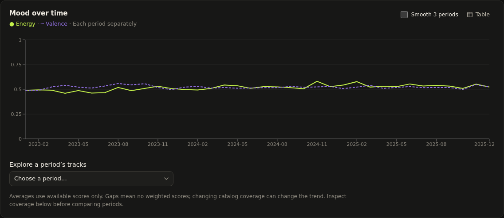

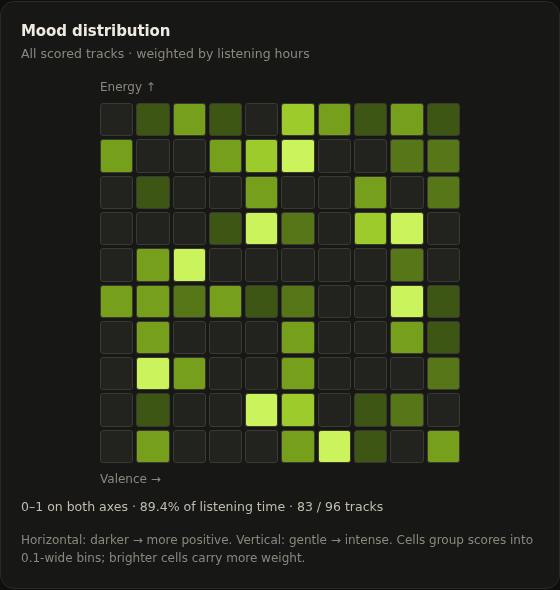

</details>

<details>
<summary>Artist mix over time and top favorites</summary>

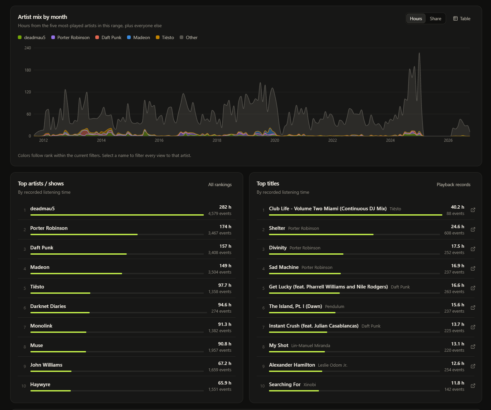

</details>

<details>
<summary>Listening highlights and streaks</summary>

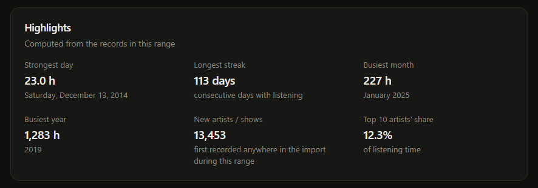

</details>

<details>
<summary>Artist and show rankings</summary>

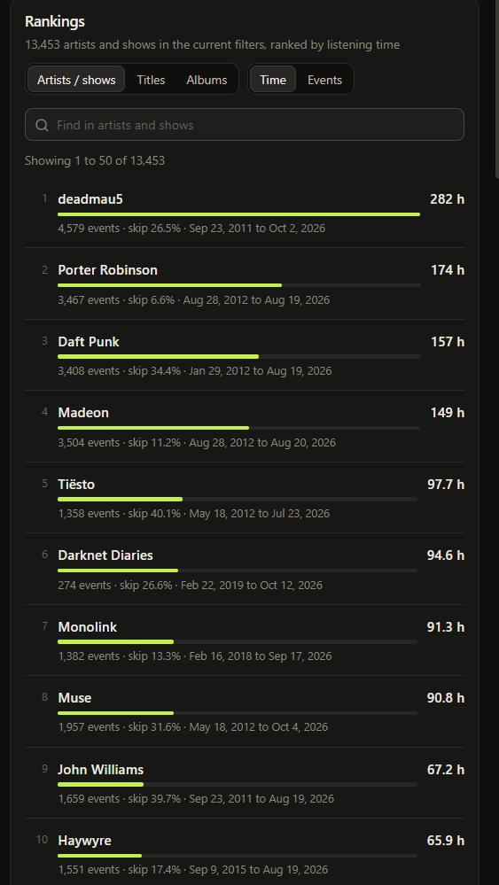

</details>

<details>
<summary>Title rankings</summary>

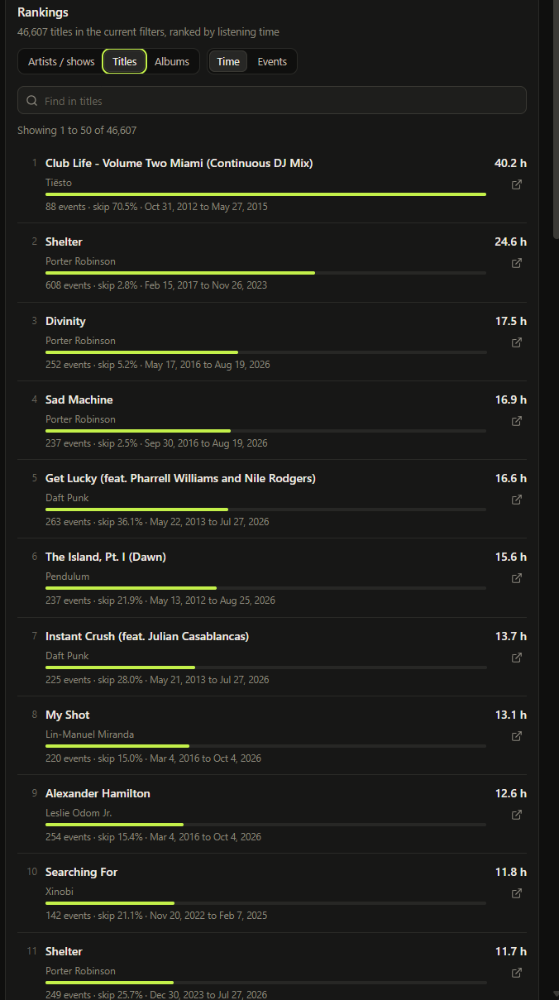

</details>

<details>
<summary>Album rankings</summary>

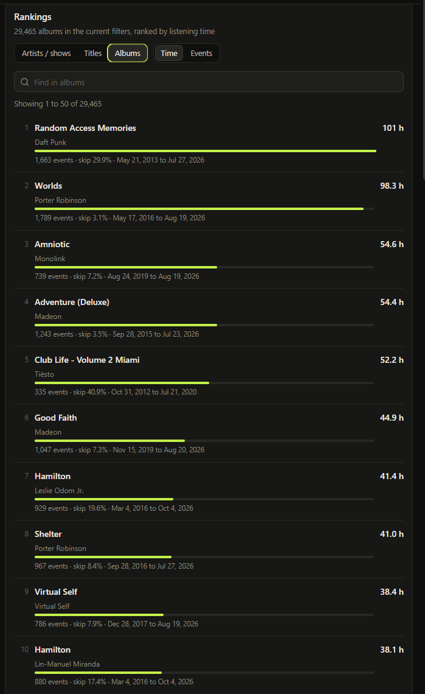

</details>

## How the numbers work

The source is Spotify's [Extended Streaming History schema](https://support.spotify.com/us/article/understanding-your-data/), plus the `ReadMeFirst_ExtendedStreamingHistory.pdf` included with the download.

| Measurement | Definition |
| --- | --- |
| Listening time | Sum of the exported `ms_played` values. Overlapping sessions may count simultaneously, so this is not elapsed wall-clock time. |
| Events | Every retained playback record, including zero-duration events unless filtered out. |
| Plays ≥30 seconds | Events with at least 30,000 milliseconds played. This is an app convention, not a claim about Spotify's billing or Wrapped rules. |
| Distinct titles | Spotify URI, falling back to content type + creator + title + album. Tracks, episodes, and audiobook chapters are included when selected. |
| Artists / shows | Distinct exported creator names. Spotify supplies artist names, not artist IDs; equally named creators may be combined. Audiobooks use the book title because author metadata is absent. |
| Skip rate | Records with `skipped=true` divided by records with a known boolean skip flag. Unknown flags are excluded from the denominator. Playback ending reasons are shown separately. |
| Active day / streak | A calendar day with positive recorded listening time, and consecutive such days, within the selected timezone and filters. |
| New artist | First appearance in the entire imported history falls in the relevant selected period. This is first recorded exposure, not necessarily real-world discovery. |
| Familiar listening | Share of listening time spent on a title recorded on an earlier calendar day. First-seen dates use the full import even when the view is filtered. |
| Yearly taste overlap | Jaccard overlap of each year's top 20 creators by recorded time with the previous year: intersection divided by union. Small or partial years are not equivalent to complete years. |
| Rediscovery | At least 180 calendar days between consecutive positive-duration records of the same title among the filtered records. Filters may lengthen these gaps. |
| Correlation | Pearson r between daily listening minutes and distinct titles, using days with positive recorded time. It is descriptive; more listening naturally provides more opportunities to hear titles. Fewer than three days or constant values produce no estimate. |

Timestamps record when playback **ended**, in UTC. All duration is assigned to that ending hour/day/month after timezone conversion; sessions crossing midnight are not split. Zero-filled calendar days mean no events in this export and selected population, not proof that you listened to nothing. Partial first/last years are marked. Historical travel timezones cannot be reconstructed from the export, so one chosen timezone applies to all years.

Exact source records within the same audio/video category are deduplicated using a stable source-record fingerprint before personal fields are discarded. Records differing in source details are preserved. The web app uses a timestamp plus two compact hashes; Android uses SHA-256. These identifiers serve duplicate detection. Invalid timestamps and non-integer, negative, or out-of-range durations are excluded and counted. URI-less items are supported. Playback platform strings are grouped into broad device families; country codes reflect connection country, not an inferred home address.

Genre, BPM, danceability, mood, track release dates, and true track durations are absent from Spotify's export. Optional catalog enrichment adds only the fields returned by its provider. The app does not infer completion percentages or fill absent scores with zero.

## Development and validation

```sh
npm test
npm run build
npx playwright install chromium
npm run test:e2e
```

`npm test` checks independent small fixtures for deduplication, privacy, weighted rates, DST/date filtering, discovery, calendar continuity, pagination, CSV injection protection, correlation, mood coverage/weighting/smoothing, exact-ID joins, metadata validation, and rate-limit handling. Browser tests cover chart rendering, metadata/history import, weighting, filters, export, persistence, and error recovery. `npx tsx scripts/generate-mood-fixtures.ts` regenerates the six shared native/web mood cases. `npx tsx scripts/validate-local.ts` additionally reconciles your ignored local dataset across summaries, rankings, monthly/daily/hourly charts, and filtered history; its detailed output stays in `.private/`.

The frontend uses React, TypeScript, Vite, Recharts, and locally bundled icons. `src/lib/normalize.ts` owns history validation, `analytics.ts` and `mood.ts` own calculations, `metadata.ts` owns the portable metadata contract, and `worker.ts` keeps parsing and aggregation off the UI thread. There is no application backend, telemetry, advertising, or third-party runtime asset dependency. Optional catalog fetching calls only `https://api.reccobeats.com` with track IDs; configure that origin in `connect-src` if your static host uses a Content Security Policy. Offline metadata imports work without API access.

## Static hosting

`npm run build` produces `dist/`, which can be hosted on GitHub Pages or another static host. Publish only `dist/`, never `.local-data`. Each visitor imports their own data in their own browser. For local preloading use `npm start`; a static host intentionally has no local-data endpoint. Browser data belongs to its origin and does not transfer between localhost and hosted versions.

The project is independent of Spotify and is not endorsed by Spotify.
